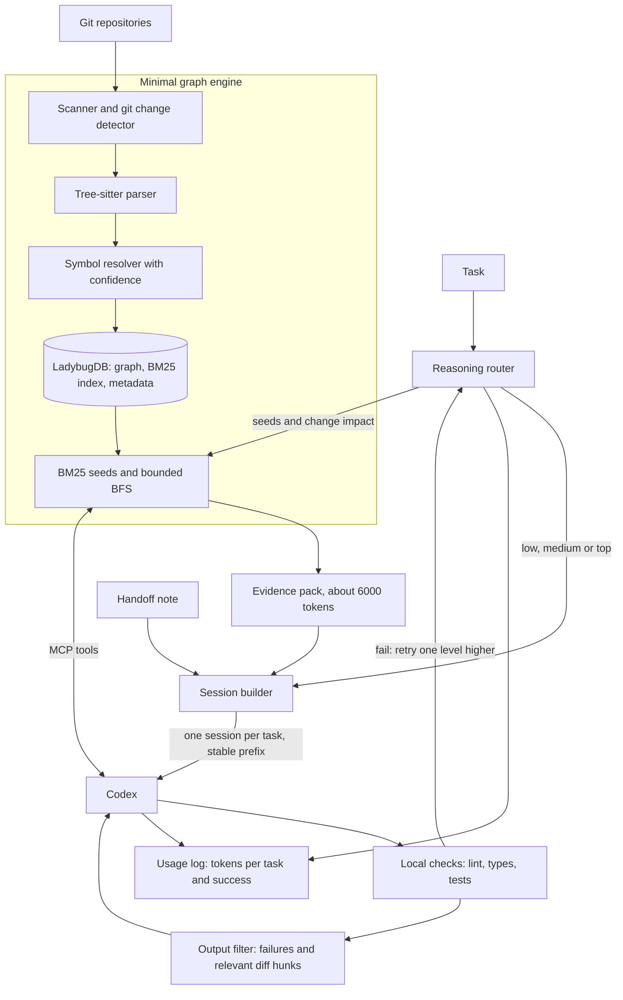
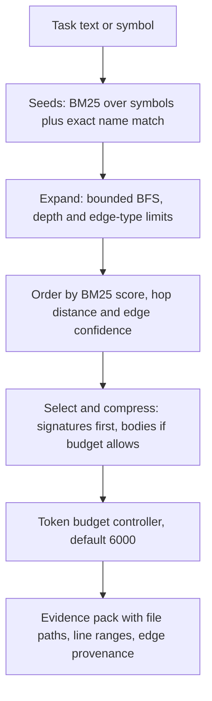

# Local Graph Intelligence Engine: Rust Development Plan

Nov 12, 2026

## 0. Cost target and order of work

Target: the same Codex work at half the monthly cost or less, at the top reasoning
level, running around the clock.

The graph alone will not reach this. It mostly cuts repository-exploration tokens,
not reasoning or output tokens. The plan therefore uses five steps, in this order:

| Order | Step | What it does | Estimated saving (unmeasured) |
|---|---|---|---|
| 1 | Measure | Log input, cached input, reasoning and output tokens per task, plus task success | none; it makes the others provable |
| 2 | Reasoning router | Picks the reasoning level from the graph's change-impact result | 20 to 30% |
| 3 | Short sessions | One session per task, started from a graph evidence pack of about 6,000 tokens and a short handoff note, with a stable prompt prefix for caching | 10 to 15% |
| 4 | Minimal graph engine | Tree-sitter, symbol resolution, bounded BFS and BM25 only | 10 to 20% |
| 5 | Output filter | Lint, types and tests run locally; only failures and relevant diff hunks go back to the model | 5 to 10% |

The savings overlap, so the combined expectation is roughly 45 to 60%. None of these
figures is measured yet.

### The reasoning router

The router decides how much reasoning a task gets before the session starts.

| Change-impact result | Reasoning level |
|---|---|
| One file | low |
| Several files in one service | medium |
| Cross-service or architecture | top |

- **Input.** The task text. The router finds seed symbols with BM25, then asks the
  graph for the change impact: files and services touched.
- **Output.** A reasoning level, the evidence pack, and the reason for the choice, all
  written to the usage log.
- **Escalation.** If local tests fail after the session, the task is retried one level
  higher. Escalations are logged, so the thresholds can be tuned from data.
- **Safety rule.** When the graph has low confidence or unresolved edges around the
  seeds, the router chooses the higher level.
- **Dependency.** The router needs the graph, so it ships in two versions: v0 counts
  the files and services of the BM25 seeds (available after phase 1), and v1 uses the
  full change-impact traversal (after phase 2).

## 1. What changed from the ChatGPT plan

The goal is unchanged: a local-first code graph engine that gives Codex Desktop a
small, verified context over CLI and MCP, so the model spends fewer tokens exploring
the repository.

| Area | ChatGPT plan | This plan |
|---|---|---|
| Language | Python, Typer, NetworkX, Python MCP SDK | Rust only, one static binary |
| Storage | LadybugDB plus SQLite | LadybugDB only; index metadata and job state live in LadybugDB tables |
| Keyword search | Separate BM25 component | LadybugDB FTS extension (BM25) |
| Graph algorithms | NetworkX | Bounded BFS in Cypher; PageRank deferred to phase 6 |
| Community detection | Leiden | Louvain from the LadybugDB algo extension, deferred to the last phase |
| Symbol resolution | LSP, SCIP, CodeQL | Own import-based resolver with confidence scores; no external analyzers in v1 |
| Order of work | Build all layers, benchmark at the end | Baseline first, thin end-to-end slice early, benchmark gate before advanced features |

## 2. Architecture

One process owns the database. The same binary runs as a CLI and as an MCP server.



Principles:

- The engine is independent of Codex. Anything that speaks MCP or can call the CLI can use it.
- Every edge records how it was found. An inferred edge is never reported as verified.
- Unresolved calls are stored as unresolved, not guessed.
- The engine returns snippets and line ranges, not whole files.

## 3. Technology stack

| Component | Choice | Purpose |
|---|---|---|
| Graph database | LadybugDB through the `lbug` crate | Graph, metadata, full-text index |
| Keyword search | LadybugDB fts extension | BM25 seed retrieval |
| Graph algorithms in the database | LadybugDB algo extension | Louvain communities and global PageRank (phase 6) |
| Vector search | LadybugDB vector extension | Optional, phase 6 |
| Parser | tree-sitter with tree-sitter-python, tree-sitter-typescript, tree-sitter-javascript | AST extraction |
| Repository walk | ignore | Respects .gitignore |
| Change detection | git2 and blake3 | Commit diff and file content hashes |
| File watching | notify | Incremental re-index |
| Parallelism | rayon | Parse files in parallel |
| In-memory graph | petgraph | Personalized PageRank on the expanded subgraph (phase 6) |
| Token counting | tiktoken-rs | Token budget controller |
| MCP | rmcp with the transport-io feature | stdio server |
| CLI | clap | Commands |
| Runtime and utilities | tokio, serde, thiserror, anyhow, tracing | Async, serialization, errors, logs |
| Tests and benchmarks | insta, criterion, tempfile | Snapshot tests, performance tests |

Languages indexed first: Python and TypeScript/JavaScript. No other database, no
Python runtime and no external analyzer is needed in v1. Deferred with their features:
petgraph, the algo extension and the vector extension are not used until phase 6.

## 4. LadybugDB schema

Version 1 keeps eight node tables. Config, Deployment and Document nodes move to phase 6.

```cypher
CREATE NODE TABLE Repository(id STRING, path STRING, head_commit STRING, PRIMARY KEY(id));
CREATE NODE TABLE Service(id STRING, name STRING, root STRING, PRIMARY KEY(id));
CREATE NODE TABLE File(id STRING, path STRING, lang STRING, content_hash STRING,
  indexed_commit STRING, indexed_at TIMESTAMP, PRIMARY KEY(id));
CREATE NODE TABLE Symbol(id STRING, name STRING, qualified_name STRING, kind STRING,
  signature STRING, doc STRING, body STRING, start_line INT64, end_line INT64,
  is_test BOOLEAN, PRIMARY KEY(id));
CREATE NODE TABLE ApiEndpoint(id STRING, method STRING, route STRING, PRIMARY KEY(id));
CREATE NODE TABLE DbTable(id STRING, name STRING, PRIMARY KEY(id));
CREATE NODE TABLE Queue(id STRING, name STRING, kind STRING, PRIMARY KEY(id));
CREATE NODE TABLE IndexRun(id STRING, started_at TIMESTAMP, finished_at TIMESTAMP,
  status STRING, files_changed INT64, schema_version INT64, PRIMARY KEY(id));
```

Every relationship table carries the same provenance columns:

```cypher
CREATE REL TABLE CALLS(FROM Symbol TO Symbol,
  confidence DOUBLE, method STRING, evidence_file STRING,
  start_line INT64, end_line INT64, commit STRING, created_at TIMESTAMP);
```

| Relationship | From | To |
|---|---|---|
| CONTAINS | Repository, Service, File | Service, File, Symbol |
| IMPORTS | File | File |
| CALLS | Symbol | Symbol |
| INHERITS, IMPLEMENTS | Symbol | Symbol |
| REFERENCES | Symbol | Symbol |
| EXPOSES_API | Symbol | ApiEndpoint |
| CALLS_API | Symbol | ApiEndpoint |
| READS_FROM, WRITES_TO | Symbol | DbTable |
| PUBLISHES, CONSUMES | Symbol | Queue |
| TESTED_BY | Symbol | Symbol |
| DEPENDS_ON | Service | Service |

Rules:

- `method` records how the edge was found. Tools label every edge with it. (The code
  uses `static`, `inferred` and `unresolved`; `runtime` is reserved for phase 6.)
- Symbol ids are stable: a hash of repository, file path, qualified name and kind. A
  re-index of an unchanged file produces the same ids.
- An unresolved call is stored as a CALLS edge to a placeholder Symbol with
  `kind = 'unresolved'` and confidence 0.
- `File.content_hash` and `File.indexed_commit` replace the SQLite metadata of the
  original plan. `IndexRun` replaces its job table.
- One FTS index covers `Symbol.name`, `qualified_name`, `signature` and `doc`.

Bulk loads go through `COPY FROM` files written by the indexer; single-file updates use
prepared statements inside one transaction.

## 5. Cargo workspace layout

```
local-graph-engine/
  Cargo.toml              workspace
  crates/
    lge-core/             node and edge types, ids, confidence, errors
    lge-index/            scanner, git diff, tree-sitter parsing, extractors
    lge-resolve/          import resolution, call graph, API, DB and queue edges
    lge-store/            GraphStore trait, LadybugDB adapter, schema migrations
    lge-retrieve/         seeds, BFS, PageRank, RRF, compression, token budget
    lge-mcp/              rmcp server and the six tool schemas
    lge-cli/              binary: lge index | query | trace | impact | mcp | watch
    lge-bench/            task runner and token accounting
    lge-usage/            reads Codex usage per task; stores tokens with the task result
    lge-router/           the reasoning router
    lge-session/          evidence pack, handoff note, stable prompt prefix; one Codex session per task
    lge-filter/           runs lint, type checks and tests locally; reduces output to failures and relevant diff hunks
  tests/fixtures/         small Python and TypeScript sample repos
```

All database access goes through the `GraphStore` trait in lge-store. No other crate
imports `lbug`. This keeps the storage decision in one place.

New commands: `lge run "<task>"`, `lge check`, `lge usage report`.

## 6. Retrieval pipeline and token budget



- **Seeds.** BM25 from the FTS index, plus exact and prefix matches on symbol names.
- **Expansion.** Bounded traversal with a depth limit, an edge-type filter and a cap on
  returned nodes.
- **Ordering.** BM25 score first, then fewer hops, then higher edge confidence. No
  PageRank and no rank fusion in the minimal engine.
- **Compression.** Emit signature and docstring first. Add the body only for the top
  symbols. Merge overlapping line ranges and drop duplicates.
- **Budget.** Count tokens with tiktoken-rs and stop when the budget is reached.
- **Stable prefix.** The pack is appended after a fixed system and tool prefix that
  never changes between sessions, so the prefix can be served from the prompt cache.
- **Deferred to phase 6.** Personalized PageRank, Reciprocal Rank Fusion and vector search.

The same pipeline serves two callers: the session builder, which asks for one evidence
pack before the session starts, and Codex itself, which can ask for more through the
MCP tools.

## 7. MCP tools and Codex configuration

Tool descriptions stay short, because they also cost context tokens.

| Tool | Input | Output |
|---|---|---|
| search_code_context | question, optional service, optional token budget | ranked symbols and files with scores and evidence |
| trace_execution_flow | symbol or API id, direction, max depth | call path with line references |
| analyze_change_impact | changed file or symbol | affected symbols, APIs, services, tests |
| find_dependencies | symbol, file or service | upstream and downstream edges with provenance |
| get_relevant_source | symbol ids or file and line ranges | exact snippets with path, lines, commit |
| get_architecture_context | question, optional service | service relationships, APIs, queues, tables |

Every result includes the indexed commit. If a file changed after it was indexed, the
server re-indexes that file before answering.

```toml
[mcp_servers.local_graph]
command = "lge"
args = ["mcp", "--repo", "/path/to/repo"]
startup_timeout_sec = 20
```

## 8. Roadmap

- **Phase 0: Measure and decide.** lge-usage logs input, cached input, reasoning and
  output tokens, the reasoning level used and task success per task. Classify past
  tasks by hand. Benchmark GitNexus. Prove LadybugDB from Rust.
- **Phase 1: Indexer, store and router v0.** Scanner, content hashing, Tree-sitter for
  Python and TypeScript; GraphStore trait, LadybugDB adapter, BM25 index, `lge index`
  and `lge query`; router v0; `lge run` starts a session at that level and logs the choice.
- **Phase 2: Resolution, change impact and router v1.** Imports to files and calls to
  symbols across files with a confidence per edge. API routes, HTTP client calls,
  database table reads and writes, RabbitMQ publish and consume, test-to-symbol links.
  Bounded BFS for `lge trace` and `lge impact`. Router v1 uses the impact result.
- **Phase 3: Short sessions and evidence pack.** lge-session: evidence pack with the
  token budget controller, handoff note written at the end of each task, fixed prompt
  prefix. One session per task.
- **Phase 4: MCP tools, output filter and incremental indexing.** rmcp stdio server
  with the six tools, file watcher and freshness check. lge-filter and `lge check`.
- **Phase 5: Benchmark each lever.** Switch the levers on one at a time on live work.
- **Phase 6: Deferred.** Personalized PageRank and rank fusion, Louvain or Leiden
  communities, vector search, CodeQL data flow, runtime graphs, history across commits.

## 9. Benchmark and go/no-go gate

| Metric | How it is measured |
|---|---|
| Input, reasoning, output and total tokens | Codex usage per task, with and without the engine |
| Context overhead | Tokens spent on tool descriptions and tool results |
| Retrieval precision and recall | Returned files against the files the finished task touched |
| Task success | The change works and tests pass |
| Latency | End-to-end time per task |
| Freshness | Results are correct after a source edit |

Gate: monthly cost at most half the baseline for the same volume of completed tasks, with task
success no lower than the baseline. Each lever is measured on its own, so a lever that
does not pay is switched off rather than kept.

## 10. Risks and items to verify

| Risk | What to do |
|---|---|
| Extensions from a Rust binary need the linker flag `-rdynamic` in build.rs | Proved for fts and vector on macOS arm64; algo fails to load (missing libnetworkit.dylib) |
| Toolchain versions: rmcp 3.x requires a newer Rust than lbug does | Pin both crate versions |
| LadybugDB is young and releases often | Pin the version, keep all access behind GraphStore |
| Concurrent writers: one read-write process | The MCP server process owns all writes, including the watcher |
| Python and JavaScript are dynamic | Store unresolvable calls as unresolved; measure how often retrieval is hurt |
| Own resolver is the largest piece of work | Phase 2 exit is a measured precision, not a feature list |
| The graph can add tokens instead of saving them | Measure context overhead separately and keep tool descriptions short |
| The router sends a hard task to a low level | Safety rule on low graph confidence, escalation on failure |
| Retries after escalation can cost more than they save | Log retry cost per task and count it against the router's saving |
| Whether Codex allows the reasoning level to be set per session | Confirm in the Codex documentation; the router depends on it |
| Prompt caching only helps if the prefix is byte-identical | Keep tool descriptions and system text fixed and versioned |
